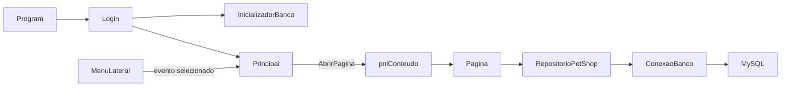
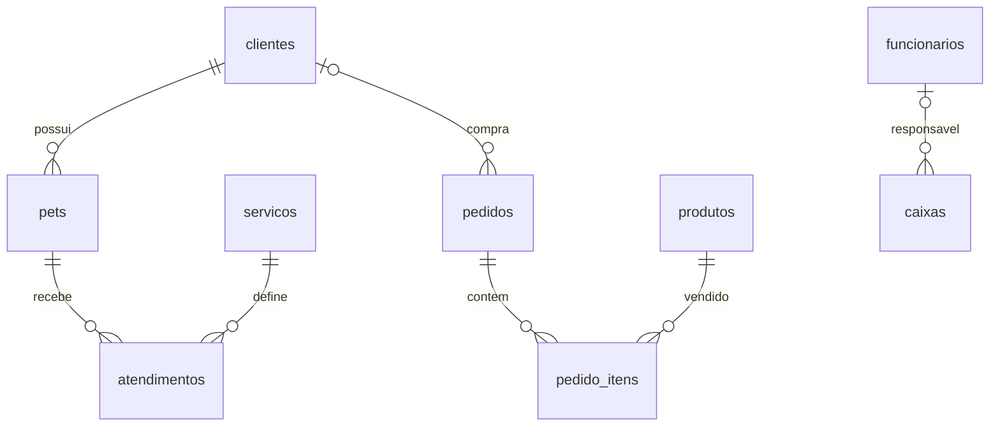

# Funcionamento e análise do PetShop

## Estrutura

Projeto WinForms em .NET 8 para Windows. FontAwesome.Sharp fornece ícones; MySqlConnector executa as consultas. Não há API intermediária nem ORM: o aplicativo acessa o MySQL diretamente.

- `Program.cs`: inicializa o WinForms e executa Login.
- `Telas/`: formulários e páginas. `.Designer.cs` cria e posiciona controles; `.cs` liga eventos e implementa ações; `.resx` armazena recursos.
- `Componentes/`: menu, formulário reutilizável, botões de edição/remoção, tema e avisos.
- `Modelos/`: objetos que transportam registros entre banco e telas.
- `Dados/`: configuração, conexão, inicialização, SQL e repositório.
- `Recursos/` e `Properties/`: imagens e recursos incorporados.

## Da abertura à navegação

1. `Application.Run(new Login())` mantém o ciclo de mensagens da aplicação.
2. `btnEntrar.Click += btnEntrar_Click` associa o clique à validação. O botão é desabilitado durante a tentativa.
3. `InicializadorBanco.InicializarAsync()` cria banco/tabelas ausentes e insere exemplos. Isso acontece em cada tentativa de login com campos preenchidos, antes de validar credenciais.
4. `AutenticarAsync` consulta funcionário ativo por usuário e senha. Apesar de algumas mensagens mencionarem e-mail, a consulta usa somente `usuario`.
5. O login se oculta, abre `Principal(nome, perfil)` com `ShowDialog()` e fecha quando a janela principal termina.
6. A principal configura o usuário no menu e abre o painel no evento `Shown`.

Por exemplo, clicar em Pets chama `Selecionar(btnPets, PetsSelecionado)` no menu. Esse método altera a cor e dispara `PetsSelecionado`. A principal escuta esse evento e executa `AbrirPagina(new PaginaPets())`.

`AbrirPagina` remove os controles do painel central, define `DockStyle.Fill` e adiciona a nova página. As páginas são `UserControl`, não janelas independentes. Cada clique cria outra instância: filtros e carrinho não são preservados ao navegar. O código atual usa `Controls.Clear()` sem descartar explicitamente a página anterior.

## Telas e ações

| Tela | Ações conectadas | Comportamento |
| --- | --- | --- |
| Login | Entrar | Valida campos, inicializa banco, autentica e abre Principal. Lembrar Senha ainda não tem implementação. |
| Painel | Carregamento | Consulta atendimentos, pets e pedidos; preenche grade e indicadores. |
| Clientes | Cadastrar, Editar, Remover, pesquisar | Agora permite o CRUD completo. Pesquisa nome/telefone; edição mantém ID; remoção respeita vínculos. |
| Pets | Cadastrar, Editar, Remover, pesquisar | Cadastro exige tutor. Pesquisa pet/tutor. Edição atual não oferece espécie nem nascimento. |
| Serviços | Cadastrar, Editar, Remover | Define nome, descrição, valor e duração. O modelo tem Ativo, mas o formulário não oferece alternância. |
| Agendamentos | Novo, Editar, Remover | Usa PaginaAtendimentos com título Agendamentos. |
| Atendimentos | Novo, Editar, Remover | Mesma consulta e componente dos agendamentos. Edição altera data, status e observações. |
| PDV | Buscar, Adicionar, Remover item, Limpar, Finalizar, Abrir/Fechar caixa | Monta carrinho em memória e registra a venda no banco. |
| Pedidos | Atualizar | Consulta resumo de pedidos e soma os concluídos. Ainda não mostra itens nem permite alterar status. |
| Estoque | Novo produto, Editar, Remover, pesquisar | Pesquisa nome/código e identifica estoque menor ou igual ao mínimo. |
| Gestão, Relatórios, Funcionários, Auditoria | Nenhuma | Botões desenhados no menu, sem eventos de navegação. |

A busca global da Principal também está desenhada, mas não possui evento de pesquisa.

## Como os botões de cadastro funcionam

`InitializeComponent()` constrói os controles; as linhas `Click += ...` conectam os botões aos métodos. `Load += ...` carrega os dados quando o componente é apresentado. `TextChanged += ...` pesquisa conforme a digitação.

`FormularioCadastro` monta uma janela modal a partir de Texto, Combo, Numero e Data. Salvar retorna `DialogResult.OK`; Cancelar retorna Cancel. A página lê os campos, monta um modelo, chama o repositório e recarrega a grade. O botão Salvar não acessa o banco sozinho.

`BotoesCrud.Adicionar` cria Editar e Remover em tempo de execução. Por isso esses botões não aparecem declarados no Designer de cada página. Ele recebe métodos `Func<Task>` para executar as ações. As grades são somente leitura: selecionar uma linha identifica o registro; editar diretamente uma célula não grava dados.

Na tela Clientes, a linha selecionada fornece o objeto Cliente por `DataBoundItem`. O formulário preenche os dados existentes, valida nome antes de fechar e respeita os tamanhos das colunas. O UPDATE usa o ID original. Remover pede confirmação; erro MySQL 1451 informa que há pets ou pedidos vinculados. Outras falhas recebem mensagem própria. Um bloqueio evita operações simultâneas nessa página e uma versão de pesquisa impede respostas antigas de substituir resultados recentes.

## Relações no MySQL

O ID é a ligação real. Por exemplo, `pets.cliente_id` aponta para `clientes.id`; o JOIN recupera o nome do tutor para exibir. Alterar o nome do cliente mantém a ligação porque o ID continua igual. As chaves estrangeiras impedem apagar registros ainda referenciados. Não é necessário remover histórico para editar os dados de contato.

A configuração padrão é 127.0.0.1:3306, banco petshop_central, usuário root, senha vazia. Laragon inicia o serviço MySQL; não participa diretamente dos eventos das telas. `ConfiguracaoBanco` permite substituir esses valores por variáveis PETSHOP_DB_*. Cada método cria sua conexão e libera os recursos com `await using`. As entradas das consultas são parametrizadas.

## Venda e caixa

1. Carregar o PDV consulta produtos ativos, clientes e estado do caixa.
2. Adicionar acumula quantidade no carrinho, verificando o estoque carregado.
3. Remover exclui a linha inteira do carrinho; Limpar zera itens e desconto e seleciona consumidor final.
4. Desconto recalcula o total. A interface limita a 50%; o repositório limita a 100%.
5. Finalizar exige caixa aberto, itens e pagamento selecionado.
6. O repositório inicia uma transação, verifica caixa, insere pedido e itens e reduz estoque com condição de quantidade suficiente.
7. Sem sucesso completo, a transação não é confirmada. Com sucesso, faz Commit, limpa a venda e recarrega os produtos.
8. Abrir/Fechar caixa registra os saldos informados. O evento `StatusCaixaAlterado` atualiza a indicação do menu.

Ainda não existe `caixa_id` em pedidos: vendas não ficam vinculadas a uma sessão de caixa. A aplicação também não preenche funcionario_id na abertura. Saldo final é informado manualmente, sem conciliação automática.

## Pendências identificadas na leitura

- Login compara senhas em texto simples; perfil é exibido, mas não restringe ações. Não há tela de gestão de funcionários funcional.
- Inicialização mistura estrutura e dados fictícios. Pode recriar exemplos removidos e criar novos atendimentos de exemplo em outro dia. Separar migrações de uma carga opcional de demonstração.
- `banco_petshop.sql` sozinho não contém produtos/pedidos/itens; essas tabelas aparecem na carga fictícia e no inicializador C#.
- Alguns totais dos pedidos fictícios não correspondem aos itens inseridos.
- O faturamento do Painel soma todos os atendimentos do dia, inclusive agendados/cancelados. A grade também mostra outras datas. É preciso definir receita realizada e aplicar filtros coerentes.
- Agendamentos e Atendimentos ainda não têm filtros distintos nem verificação de conflito de horários.
- Diversos eventos async das outras telas não capturam erros; falhas de rede ou restrições podem escapar até o WinForms. A proteção adicionada nesta entrega cobre Clientes.
- PDV não bloqueia cliques repetidos durante gravação e usa número de pedido com precisão de segundos, sujeito a colisões. Repositório ainda precisa validar carrinho vazio/quantidades/preços independentemente da interface.
- Abertura de caixa verifica e insere em operações separadas: concorrência entre instâncias ainda precisa ser tratada.
- Edição de estoque permite substituir a quantidade sem histórico de movimentação.
- Cadastros têm validações parciais e as páginas antigas têm código muito concentrado em linhas únicas.

Prioridade sugerida: proteger a finalização do PDV e sessões de caixa, separar dados fictícios, corrigir indicadores, fortalecer autenticação e então implementar os módulos ainda sem ação.

## Validação desta entrega

`dotnet build PetShop_App.csproj --nologo`: passou com 0 erros e 13 avisos relativos a nulidade e campos components nos fontes existentes. Não foram executadas operações contra um MySQL real nem testes visuais interativos.

Roteiro manual em banco de desenvolvimento:

1. Iniciar MySQL no Laragon e abrir o aplicativo; entrar com admin/admin na base de demonstração.
2. Cadastrar cliente com nome, telefone, CPF e e-mail; pesquisar por nome e telefone.
3. Editar o selecionado; reabrir a página e conferir persistência.
4. Tentar salvar nome vazio: a janela deve permanecer aberta com os demais campos preservados.
5. Cancelar edição e remoção: dados devem permanecer iguais.
6. Remover cliente sem vínculos: deve desaparecer. Tentar remover cliente com pet/pedido: deve informar vínculo e preservar o registro.
7. Simular indisponibilidade do banco ao salvar: deve mostrar erro e liberar os botões.
8. Digitar uma pesquisa rapidamente: a grade deve corresponder ao último texto informado.
